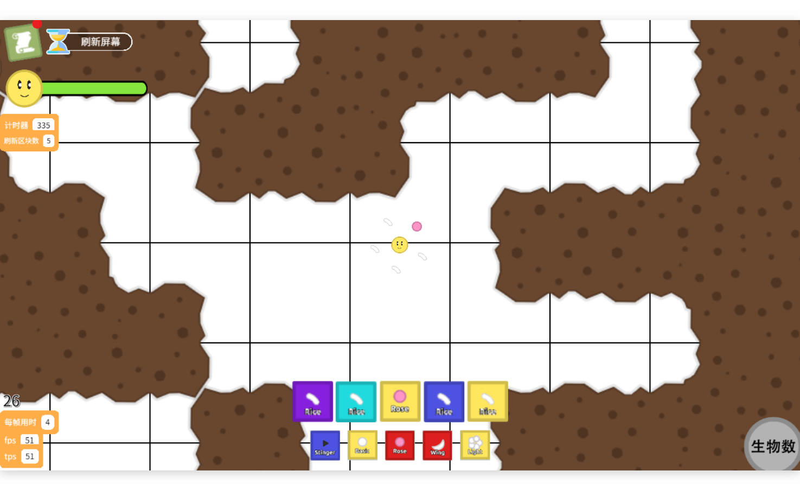

# Kitten4 播放器

把 Kitten4（编程猫）作品当普通游戏玩：**本地 `.bcm4` 双击就开，作品号粘进输入框就能玩**，不用开编辑器，也不用先绕进社区网站。




---

## 这是什么

官方播放器本身是好的，问题在于它总被包在别的东西里：想玩线上的作品得先打开社区站（导航、推荐流、评论、金币一个不少），想玩自己存在电脑里的 `.bcm4` 则必须打开整个编辑器。

这个项目把官方播放器（`player_v2`）原样搬到本地跑，外面套一个极小的壳：一个窗口、一个首页、一个本地 HTTP 服务。它**只做播放，不做编辑**。

| 能做 | 不做 |
|---|---|
| 打开本地 `.bcm4` / `.bcm` 作品 | 编辑作品、改积木 |
| 输入作品号或作品链接直接玩 | 上传、发布、分享作品 |
| 登录后让作品里的「云数据」积木真实读写 | 社区浏览、评论、点赞、金币 |

适合：想快速试玩自己或别人的作品、想脱离浏览器和社区页面专注玩的场合。
不适合：想改作品的人——请回官方编辑器。

---

## 功能

**播本地作品**
- 拖进窗口、点「选择文件」、或把文件拖到 exe 图标上
- 运行一次 `安装文件关联.bat` 后，`.bcm4` 双击直接播
- 缺编译产物的作品（编辑器里没运行过、或被裁剪过）会自动现场编译补上，不再报「打开作品失败」

**按作品号播线上作品**
- 认这几种输入：`335327306` / `player.codemao.cn/new/<id>` / `shequ.codemao.cn/work/<id>` / `pickcat.dao3.fun/works/<uuid>`
- 自动查版本，作者更新了会重下；下载完缓存在本地，第二次打开是秒级
- 断网时，之前打开过的作品照样能玩

**可选登录**
- 手机号 / 邮箱 + 密码登录编程猫账号，密码只在登录那一刻用一次，不落盘
- 登录后作品请求带身份，**自己的未公开作品也能打开**
- 作品里的云变量、排行榜之类会真的连官方服务器读写，而不是停在「预览模式下云数据以本地形式运行」的模拟状态

**其它**
- 自绘标题栏、最近打开记录、深色界面
- 快捷键：`Ctrl+O` 打开文件 · `Ctrl+L` 输入作品号 · `Ctrl+R` 重开当前作品 · `F11` 全屏

---

## 快速开始

### 用现成的绿色版

仓库里不放打包产物（单个 exe 188 MB，超出 GitHub 限制）。在本机跑一次打包脚本：

```bash
npm install
node tools/build_portable.js
```

产物在 `dist/Kitten4播放器/`，整个文件夹拷到任意位置，双击 `Kitten4播放器.exe` 即用，不必安装、不写注册表。约 240 MB，体积主要是 Electron 运行时。

如果发布页（Releases）挂了附件，也可以直接下载解压，省去打包。

详细的中文使用说明是同目录的 `使用说明.txt`（打包时自动生成）。

### 从源码直接跑

```bash
npm install
npm start          # 或 npm run dev，带开发者工具
```

需要 Node 18+ 和 Windows。首次运行会下载 Electron（约 100 MB）。

> 在 Windows Git Bash 里手动启动 Electron 时，前缀加上 `env -u ELECTRON_RUN_AS_NODE -u NODE_OPTIONS`，否则可能以 Node 模式启动、或打包脚本删除文件时报 `EBUSY`。原因写在 [docs/INTERNALS.md](docs/INTERNALS.md)。

---

## 用法

### 打开本地作品

三种方式，随便挑：

1. 把 `.bcm4` 文件拖进窗口
2. 点首页的「选择文件」
3. 把文件拖到 `Kitten4播放器.exe` 的图标上（等价于命令行带路径启动）

想双击就播，先运行一次 `安装文件关联.bat`（只写当前用户注册表）；不想用了运行 `卸载文件关联.bat`。

### 播线上作品

在首页输入框里填作品号，回车或点「在线播放」：

| 你手上的东西 | 直接粘进去就行 |
|---|---|
| 作品号 | `335327306` |
| 播放页链接 | `player.codemao.cn/new/335327306` |
| 社区作品页 | `shequ.codemao.cn/work/335327306` |
| PICKCAT 作品页 | `pickcat.dao3.fun/works/<uuid>`（会自动换成源作品号） |

第一次打开要下载作品数据（通常几 MB 到几十 MB），首页会显示解析、下载、启动的进度。下载完存到本地，下次打开只比对版本，1 秒级进画面。

### 登录（可选）

首页账号条点「登录」，填手机号或邮箱 + 密码。登录后：

- 拉作品、拉数据都带你的身份，**自己的私密作品可以直接用作品号打开**
- 作品里的云数据积木连官方服务器真实读写（排行榜、跨设备存档那类）

密码不保存。本地只留一个登录令牌，存在 `%APPDATA%\kitten4-player\account.json`，点「退出」即删。不登录也能玩，只是云数据按本地模拟跑。

### 键盘

| 按键 | 作用 |
|---|---|
| `Ctrl+O` | 打开文件 |
| `Ctrl+L` | 回到首页并选中作品号输入框（播放中也能用） |
| `Ctrl+R` | 重开当前作品 |
| `F11` | 全屏 / 退出全屏 |

---

## 常见问题

**提示「作品积木还有点小问题」，画面卡在初始化**

作品自身有错，和播放器无关。播放器会把真正的异常打到控制台（用 `K4P_LOG=1` 启动能看到），常见原因是积木的边界情况，例如列表取第 0 项——Kitten 的列表下标从 1 开始。只能回编辑器修。

**提示「作品不存在或未公开」**

作品号写错了、作品被作者删了，或者是别人的私密作品。后者登录自己的账号也打不开，需要作者公开。

**提示「预览模式下，云数据会以本地形式运行」**

没登录，或者这个作品根本没用到云变量。登录后重开作品即可。如果登录了仍然提示，检查作品是否真的声明了云变量。

**打开后一直停在「加载图片资源 (0/174)」**

大作品首次加载确实慢，等 20~30 秒再看。如果一直不动，多半是作品需要的素材在 CDN 上取不到（网络问题），换网络重试。

**玩过的作品、设置都存哪**

```
%APPDATA%\kitten4-player\
  state.json      最近打开记录
  account.json    登录令牌（点退出即删）
  online\         在线作品缓存，删掉即可释放空间（会重新下载）
```

在资源管理器地址栏粘贴 `%APPDATA%\kitten4-player` 就能打开。

**有 mac / Linux / 手机版吗**

没有。目前只打包了 Windows x64，代码本身是 Electron，理论上换平台重新打包即可，但没测过。

---

## 它为什么比官方页面快

不是因为播放器换了实现——用的就是官方 `player_v2`。快在两层：

**一、砍掉外壳。** 官方社区页要先加载整个社区站，播放器只是其中一块；这里直接裸加载播放器。这也是 PICKCAT 那类第三方站点「比原版快」的全部原因（它甚至没有自己的播放器，只是把官方播放器 iframe 进去）。

**二、改运行时。** 这部分是本项目自己做的：

| 改动 | 效果 |
|---|---|
| 数学积木从 decimal.js 改原生浮点 | 单次运算 1337 ns → 21.7 ns（约 60×） |
| 去掉代码生成器里只为编辑器高亮服务的调度指令 | 生成源码 9.86 MB → 4.59 MB（−53%） |
| 作品数据本地托管 + 缓存 | 第二次打开 1 秒级，断网可玩 |

florr（335327306）实测「每帧用时」从 0.16 降到 0~0.09，画面里那个 `fps 51` 就是它跑出来的。更完整的逆向过程、接口细节、踩过的坑都在 [docs/INTERNALS.md](docs/INTERNALS.md)。

---

## 已知限制

- 仅 Windows x64，仅在 Windows 11 上测过
- 只做播放，作品自身的问题（积木写错、素材缺失）仍需回编辑器
- 云数据与账号相关功能依赖官方服务，官方接口变更会导致登录 / 在线播放失效
- 控制台有一条 `Failed to construct 'URL': Invalid URL`，来自 Electron 自身 `renderer_init`，与项目无关，不影响播放

---

## 声明

本项目为个人学习与研究用途：通过本地托管官方播放器，运行自己拥有或公开的作品。游戏内容、运行时、商标均归编程猫 / Kitten4 官方所有。

请遵守官方服务条款：不要用登录态做自动化批量请求，不要用它分发他人作品，也不要用于绕过平台的付费或权限机制。源码仅供学习交流。
